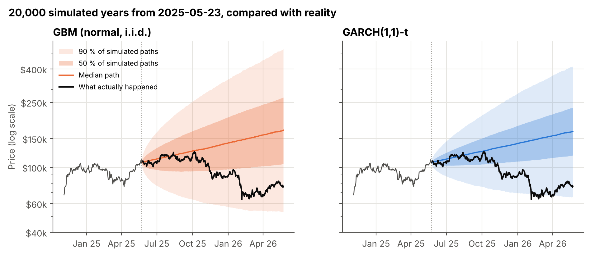
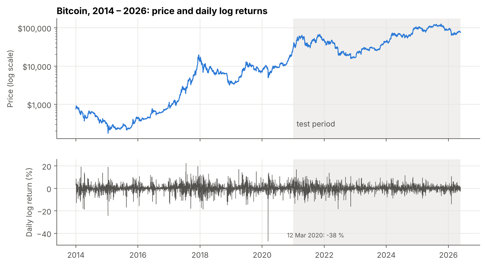
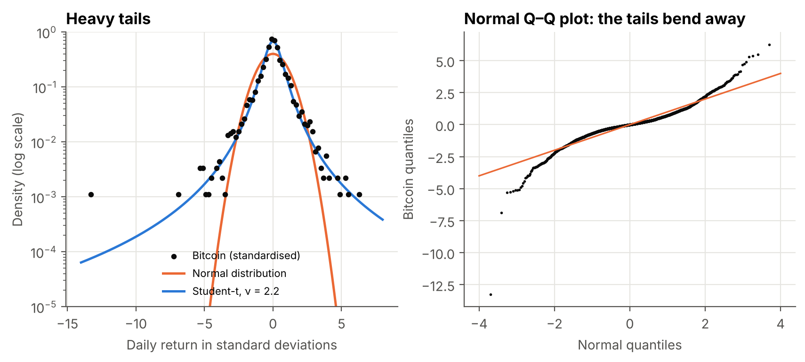
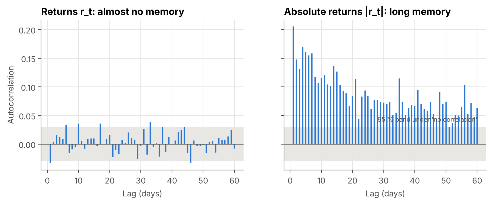
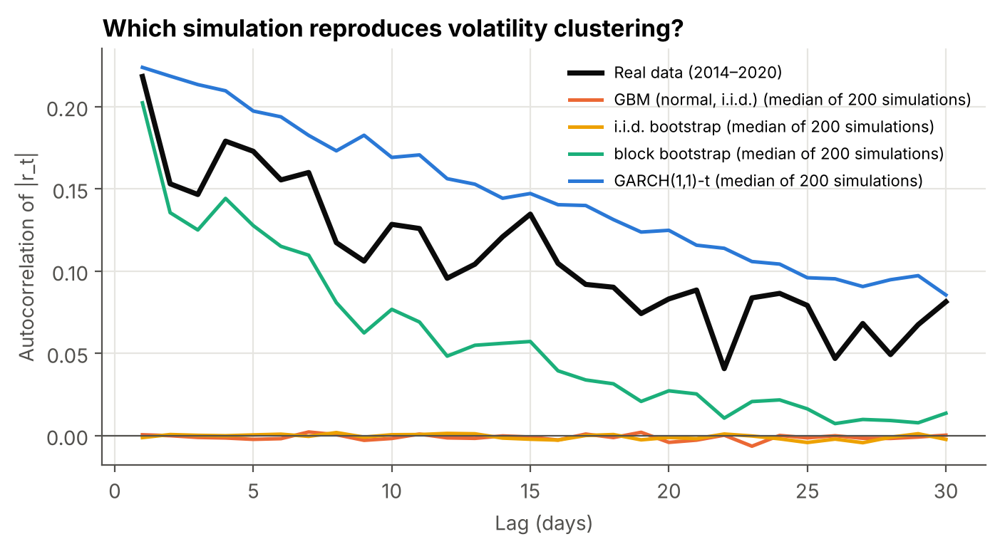
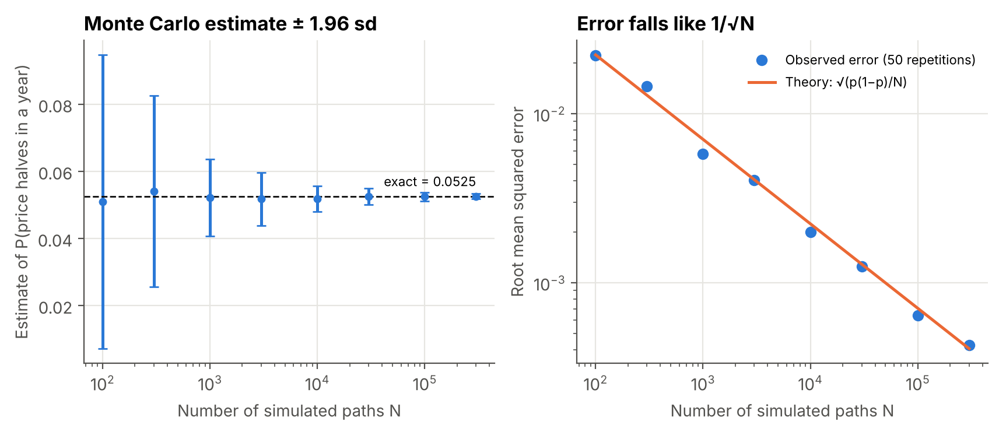
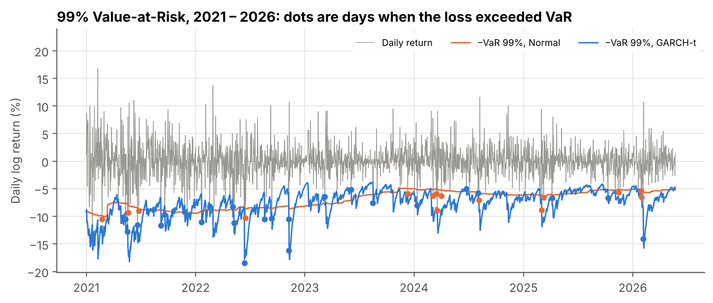
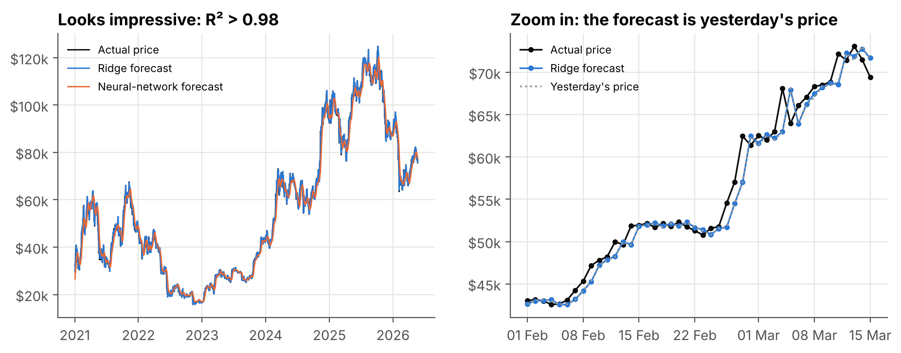
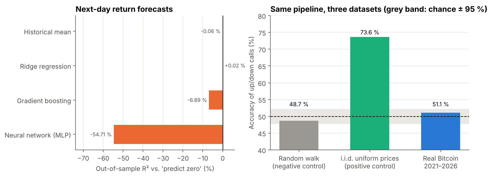

# Can Bitcoin Be Predicted? Simulation, Risk and an Honest Test

[](https://github.com/Zahra798/bitcoin-simulation-and-predictability/actions/workflows/tests.yml)


*A rebuilt version of my course project for **Simulation** (B.Sc. Mathematics and its Applications), "Bitcoin price
prediction with neural networks".*

> **Authorship note.** The original course project used randomly generated numbers in place of real prices, so its
> models could only reach chance-level accuracy (52 %). This version was rebuilt in 2026 on real data, with the help of
> an AI assistant (Claude). I reviewed and tested it, and I am able to explain every part of it.

Using 12 years of real daily data (2014 – May 2026), this project asks three questions about Bitcoin:

1. **Simulation:** which stochastic model produces price paths that *look like* Bitcoin? Candidates are geometric
   Brownian motion, two bootstraps and a GARCH model estimated by maximum likelihood.
2. **Risk:** how large can tomorrow's loss be? Value-at-Risk forecasts are checked with formal statistical backtests.
3. **Prediction:** can machine learning forecast tomorrow's move? The answer is tested with walk-forward evaluation,
   significance tests and *positive and negative controls*.

### Highlights

- **Bitcoin is not Gaussian.** Annualised volatility is 68 % and excess kurtosis is 11. There were 24 days beyond 4σ;
  a normal distribution predicts 0.3. Volatility clusters strongly (Ljung–Box on |r|: p < 10⁻²⁰⁰), while returns
  themselves show almost no memory.
- **GARCH(1,1)-t, estimated from first principles.** Volatility shocks have a half-life of **58 days** and the
  innovations have Student-t tails with **ν ≈ 3.3**. The model improves the log-likelihood over the normal model
  by **617**. Of the four simulators, only GARCH reproduces the slow decay of volatility clustering.
- **Value-at-Risk under audit.** The normal model fails the 99 % Kupiec test (34 violations where about 20 are expected,
  p = 0.003). Historical simulation and GARCH-t pass. GARCH-t does so with a lower average capital requirement.
- **The "R² = 0.99" illusion.** Every price-level model reaches R² > 0.98, the setup of the original project. None of them
  beats "tomorrow = today": the forecast is simply yesterday's price.
- **No predictability in returns, and the pipeline can prove it.** On next-day returns, the best model's out-of-sample R²
  is +0.02 % (Diebold–Mariano p = 0.95), and up/down accuracy is 51 % (p = 0.40 vs. "always up"). The same pipeline finds
  **73.6 %** accuracy on a dataset where predictability is known to exist (the theoretical maximum there is 75 %), and
  49 % on a pure random walk. So the negative result on Bitcoin reflects the data, not a broken method.



---

## Contents

1. [Data](#1-data)
2. [Stylised facts](#2-stylised-facts)
3. [Simulation models](#3-simulation-models)
4. [Value-at-Risk](#4-value-at-risk)
5. [Is the next day predictable?](#5-is-the-next-day-predictable)
6. [Reproducing the results](#6-reproducing-the-results)
7. [Limitations](#7-limitations)
8. [References](#8-references)

---

## 1. Data

Daily data from the [Coin Metrics Community Network Data](https://github.com/coinmetrics/data) (CC BY-NC 4.0): the
reference price in USD, reported spot volume, active addresses, transaction count and hash rate. The study uses
1 Jan 2014 – 23 May 2026 (4,526 daily returns, no calendar gaps). Models are fitted on **2014–2020** and judged on
**2021 – May 2026**. Details are in [`data/README.md`](data/README.md).

The object of study is the **daily log return** $r_t = \ln(P_t/P_{t-1})$. Log returns add up over time, which is what
makes them natural for both simulation and statistics.



---

## 2. Stylised facts

| | 2014–2020 (fit) | 2021–2026 (test) | 2014–2026 |
|---|---|---|---|
| Annualised volatility $\hat\sigma\sqrt{365}$ | 75 % | 57 % | 68 % |
| Skewness | −0.81 | −0.14 | −0.65 |
| Excess kurtosis | 12.1 | 3.9 | 11.2 |
| Days beyond 4σ (observed / expected if normal) | 15 / 0.16 | 7 / 0.12 | 24 / 0.29 |

**Heavy tails.** The Jarque–Bera statistic $\mathrm{JB}=\tfrac{n}{6}\big[S^2+\tfrac{(K-3)^2}{4}\big] = 23{,}982$
rejects normality without any doubt. On a log scale, the normal density falls far below the observed tails, while a
Student-t follows them:



**Memory.** The Ljung–Box statistic $Q = n(n+2)\sum_{k=1}^{m}\hat\rho_k^2/(n-k)\sim\chi^2_m$ (implemented from its
formula) gives:

| Series | Q (30 lags) | p-value |
|---|---|---|
| returns $r_t$ | 39 | 0.12 |
| absolute returns $\lvert r_t\rvert$ | 1,797 | < 10⁻²⁰⁰ |
| squared returns $r_t^2$ | 280 | < 10⁻⁴⁰ |

The *direction* of moves has almost no memory, but their *size* has a lot: calm and turbulent periods persist.
This is **volatility clustering**.



---

## 3. Simulation models

All four simulators are implemented in [`btcsim/simulate.py`](btcsim/simulate.py).

| Model | Definition | Keeps heavy tails? | Keeps volatility clustering? |
|---|---|---|---|
| **GBM** (Black–Scholes) | $dS_t=\mu S_t\,dt+\sigma S_t\,dW_t\ \Rightarrow\ r_t\overset{iid}{\sim}\mathcal N(\mu-\tfrac{\sigma^2}{2},\sigma^2)$ | no | no |
| **i.i.d. bootstrap** | resample historical returns with replacement | yes | no |
| **Stationary block bootstrap** (Politis & Romano, 1994) | copy blocks of consecutive days, lengths $\sim$ Geometric(1/20) | yes | partly |
| **GARCH(1,1)-t** (Bollerslev, 1986) | $r_t=\mu+\sigma_t z_t,\ \ \sigma_t^2=\omega+\alpha\varepsilon_{t-1}^2+\beta\sigma_{t-1}^2,\ \ z_t\sim t_\nu$ (unit variance) | yes | yes |

**Estimating GARCH by maximum likelihood.** The log-likelihood

$$
\ell(\mu,\alpha,\beta,\nu)=\sum_t\Big[\log\Gamma\!\big(\tfrac{\nu+1}{2}\big)-\log\Gamma\!\big(\tfrac{\nu}{2}\big)
-\tfrac12\log\big(\pi(\nu-2)\sigma_t^2\big)-\tfrac{\nu+1}{2}\log\Big(1+\tfrac{\varepsilon_t^2}{(\nu-2)\sigma_t^2}\Big)\Big]
$$

is maximised with SLSQP under the stationarity constraint $\alpha+\beta<1$. *Variance targeting* sets
$\omega=\hat v(1-\alpha-\beta)$, so that the model's long-run variance equals the sample variance. The variance
recursion is a first-order linear filter, run with `scipy.signal.lfilter`. A unit test checks that the estimator
recovers the parameters of a simulated GARCH process.

| Parameter (2014–2020) | Estimate | Interpretation |
|---|---|---|
| α | 0.109 | reaction to yesterday's shock |
| β | 0.879 | memory of yesterday's volatility |
| α + β | 0.988 | half-life of a volatility shock: $\ln\tfrac12/\ln(\alpha+\beta)$ = **58 days** |
| ν | 3.33 | very heavy tails (the 4th moment is infinite when ν < 4) |
| log-likelihood gain vs. normal | +617 | for two extra parameters |

**Do the simulations look like Bitcoin?** 200 synthetic histories of 2014–2020 length were generated per model
(median and 90 % range shown):

| | Excess kurtosis | ACF of \|r\|, lag 1 | ACF of \|r\|, mean of lags 1–30 | 1 % quantile of r |
|---|---|---|---|---|
| **Real data** | **12.1** | **0.218** | **0.108** | **−0.114** |
| GBM | −0.0 [−0.1, 0.2] | 0.000 | −0.001 | −0.090 |
| i.i.d. bootstrap | 11.7 [3.8, 22.8] | −0.001 | −0.001 | −0.113 |
| block bootstrap | 11.6 [4.2, 22.1] | 0.202 | 0.059 | −0.114 |
| GARCH(1,1)-t | 20.5 [6.9, 108.5] | 0.224 | 0.146 | −0.079 |

No model is perfect. GBM misses everything. The i.i.d. bootstrap gets the tails right but has no memory. The block
bootstrap keeps memory only up to its block length. GARCH-t is the only model whose volatility memory decays slowly
like the real one, but its tails are *too* wild, and it puts too little mass at the 1 % quantile.



**A real out-of-sample test.** Each model was fitted on all data up to 23 May 2025 ($107,292), and 20,000 one-year
price paths were simulated. In reality the price fell to **$76,620** (−29 %), after a maximum drawdown of 49 %:

| Model | Median simulated price | P(price ends lower) | Percentile of the actual outcome |
|---|---|---|---|
| GBM | $168,700 | 26 % | 13th |
| i.i.d. bootstrap | $169,100 | 26 % | 13th |
| block bootstrap | $165,100 | 28 % | 15th |
| GARCH(1,1)-t | $165,700 | 20 % | 7th |

All models inherit the strong historical drift ($\hat\mu$ from 2014–2025), so their median path rises by more than 50 % in a
year. The real outcome was unlucky, but not impossible under any of them. Estimating the *drift* of a volatile asset is
far harder than estimating its *volatility*: the standard error of $\hat\mu$ after $n$ days is $\sigma/\sqrt n$,
about 20 % per year even with 11 years of data.

**Monte Carlo error.** Under GBM, the probability that the price halves within a year has a closed form,
$P(S_T<S_0/2)=\Phi\big((\ln\tfrac12-(\mu-\tfrac{\sigma^2}{2})T)/(\sigma\sqrt T)\big)=0.0525$. This makes it possible to
measure the true error of Monte Carlo estimates. The observed error follows the theoretical
$\sqrt{p(1-p)/N}$ from N = 100 to N = 300,000:



---

## 4. Value-at-Risk

For every day of 2021–2026, three methods forecast the one-day VaR using only past data: **normal**
(variance–covariance, last 365 days), **historical simulation** (empirical quantile, last 365 days) and
**GARCH(1,1)-t** (re-estimated every 30 days). Hits $I_t=\mathbf 1\{r_t<-\mathrm{VaR}_t\}$ are tested with the
**Kupiec** proportion-of-failures test and the **Christoffersen** independence and conditional-coverage tests. The
**quantile (tick) loss** ranks the forecasts.

| Level | Method | Mean VaR | Violations (expected) | Kupiec p | Christoffersen cc p | Quantile loss ×1000 |
|---|---|---|---|---|---|---|
| 95 % | Normal | 4.9 % | 91 (98) | 0.44 | 0.73 | 3.495 |
| 95 % | Historical | 4.6 % | 99 (98) | 0.95 | 0.66 | 3.491 |
| 95 % | GARCH-t | 4.1 % | 124 (98) | **0.011** ✗ | **0.028** ✗ | **3.469** |
| 99 % | Normal | 6.9 % | 34 (20) | **0.003** ✗ | **0.012** ✗ | 1.115 |
| 99 % | Historical | 8.1 % | 24 (20) | 0.35 | 0.37 | **1.065** |
| 99 % | GARCH-t | 7.7 % | 25 (20) | 0.25 | 0.32 | 1.074 |

The normal model underestimates extreme losses at 99 %, which is the heavy-tail problem again. GARCH-t adapts quickly
to turbulent periods and passes at 99 % with less capital than historical simulation. At 95 %, however, its ν ≈ 3
t-distribution is so peaked that the 5 % quantile is too small. The model with the best quantile loss can still fail a
coverage test, so it is worth looking at both.



---

## 5. Is the next day predictable?

All models are evaluated **walk-forward**. For each test day from 1 Jan 2021, models may use only data up to that
day, and they are re-fitted every 30 days on all data seen so far. A unit test verifies that no model ever trains on
an answer it should not know yet.

### 5.1 The price-level illusion

The original project predicted the next day's *price*. Here, the same setup gives:

| Model (input: last 10 prices) | R² | RMSE | Theil's U (vs. "tomorrow = today") |
|---|---|---|---|
| Naive: tomorrow = today | 0.9968 | $1,630 | 1.00 |
| Ridge regression | 0.9968 | $1,643 | 1.01 |
| Neural network (min–max scaled) | 0.9880 | $3,180 | 1.95 |
| Gradient boosting | 0.9806 | $4,042 | 2.48 |

R² is close to 1 because prices are close to *yesterday's* prices. Every model is at best as good as copying
yesterday, and the correlation between predicted and actual price *changes* is about 0. Tree models and min–max-scaled
networks are even worse, because they cannot extrapolate above the highest price seen in training.



### 5.2 Returns and direction

The input has 25 features known at the end of day *t*: lagged returns, rolling volatility, distance from the 50- and
200-day averages, trading-volume changes, on-chain activity (active addresses, transactions, hash rate) and the day of
the week.

| Next-day return model | Out-of-sample R² vs. "predict 0" | Diebold–Mariano p |
|---|---|---|
| Historical mean | −0.06 % | 0.75 |
| Ridge regression | +0.02 % | 0.95 |
| Gradient boosting | −6.9 % | < 0.001 (worse) |
| Neural network (MLP) | −54.7 % | < 0.001 (worse) |

| Up/down classifier | Accuracy | p vs. 50 % | p vs. "always up" (50.8 %) |
|---|---|---|---|
| Logistic regression | 51.1 % | 0.17 | 0.40 |
| Gradient boosting | 51.4 % | 0.11 | 0.30 |

Flexible models fit noise and lose. The best one is statistically indistinguishable from predicting no change. This
agrees with the weak-form efficient-market hypothesis.

### 5.3 Controls: can the pipeline detect predictability at all?

A negative result is only convincing if the method *could* have found something. The identical pipeline was therefore
run on two synthetic datasets with known answers:

- **Negative control: a random walk.** Returns are i.i.d. normal, so nothing is predictable.
- **Positive control: the data of the original course project.** Each day's price is drawn independently from
  U(1, 100). The *level* is noise, but the *changes* are not: for i.i.d. $X_t$,
  $\operatorname{corr}(X_{t+1}-X_t,\ X_t-X_{t-1}) = -\tfrac12$, so a high price today predicts a fall tomorrow. The best
  possible accuracy is $E[\max(U, 1-U)] = 3/4$.

| Dataset | Logistic regression accuracy | p vs. 50 % |
|---|---|---|
| Random walk (nothing to find) | 48.7 % | 0.88 |
| i.i.d. uniform prices (best possible: 75 %) | **73.6 %** | < 10⁻¹⁰⁰ |
| **Real Bitcoin, 2021–2026** | 51.1 % | 0.17 |

The pipeline finds structure when it exists and finds nothing when nothing is there. Real Bitcoin behaves like the
random walk.



---

## 6. Reproducing the results

```bash
git clone https://github.com/Zahra798/bitcoin-simulation-and-predictability.git
cd bitcoin-simulation-and-predictability
pip install -e ".[dev]"

pytest                 # 16 unit tests, ~2 s
python -m btcsim       # all studies, ~8 min -> results/ and figures/
```

Seeds are fixed, so the numbers above are reproduced exactly.

**What the tests check:** Ljung–Box has the correct size under white noise and detects an AR(1); Jarque–Bera
separates normal from t data; GBM matches $E[S_T]=S_0e^{\mu T}$; the GARCH estimator recovers known parameters, and
its variance forecast uses only past data; the block bootstrap continues blocks with probability $1-1/L$; the
Kupiec statistic matches a hand computation; Christoffersen's test flags clustered violations; the quantile loss is
minimised by the true quantile; i.i.d. prices have lag-1 change correlation −½; features and walk-forward training
never see the future.

```
├── btcsim/
│   ├── config.py        periods, seeds, Monte Carlo and risk settings
│   ├── data.py          loading, log returns, the two control datasets
│   ├── stats.py         ACF, Ljung–Box, Jarque–Bera, drawdowns
│   ├── simulate.py      GBM, i.i.d. and block bootstrap, GARCH(1,1)-t (MLE)
│   ├── risk.py          rolling VaR, Kupiec and Christoffersen tests, quantile loss
│   ├── predict.py       features, walk-forward engine, Diebold–Mariano, out-of-sample R²
│   ├── experiments.py   the four studies
│   ├── plots.py         figures
│   └── __main__.py      `python -m btcsim`
├── tests/               16 unit tests, run by GitHub Actions on every push
├── data/                Coin Metrics daily data (CC BY-NC 4.0) and its description
├── results/             every table above, as Markdown and CSV
└── figures/
```

---

## 7. Limitations

- **Daily data only.** Intraday patterns, order-book data and news sentiment are outside the scope of this study.
  These are the sources where short-lived predictability is usually reported.
- **One GARCH specification.** Asymmetric models (GJR-GARCH, EGARCH) and regime-switching models could fit the
  leverage effect and the change in volatility after 2021 better.
- **No LSTM.** A recurrent network, the model of the original project, could be added under exactly the same
  walk-forward protocol and controls. Given the results above, the expected outcome is no improvement.
- **Not financial advice.** Nothing here is a trading recommendation.

## 8. References

- Bollerslev, T. (1986). Generalized autoregressive conditional heteroskedasticity. *J. Econometrics* 31(3).
- Campbell, J. Y. & Thompson, S. B. (2008). Predicting excess stock returns out of sample. *Rev. Financial Studies* 21(4).
- Christoffersen, P. F. (1998). Evaluating interval forecasts. *Int. Economic Review* 39(4).
- Cont, R. (2001). Empirical properties of asset returns: stylized facts and statistical issues. *Quantitative Finance* 1(2).
- Diebold, F. X. & Mariano, R. S. (1995). Comparing predictive accuracy. *J. Business & Economic Statistics* 13(3).
- Engle, R. F. & Mezrich, J. (1996). GARCH for groups. *Risk* 9(8).
- Glasserman, P. (2003). *Monte Carlo Methods in Financial Engineering*. Springer.
- Kupiec, P. H. (1995). Techniques for verifying the accuracy of risk measurement models. *J. Derivatives* 3(2).
- Politis, D. N. & Romano, J. P. (1994). The stationary bootstrap. *JASA* 89(428).

**Author:** Zahra Hosseini, B.Sc. Mathematics and its Applications, Iran University of Science and Technology.
Data © Coin Metrics, Inc., CC BY-NC 4.0.
